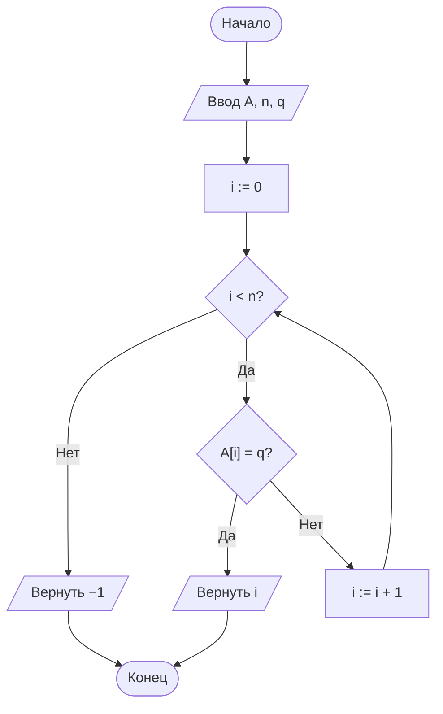
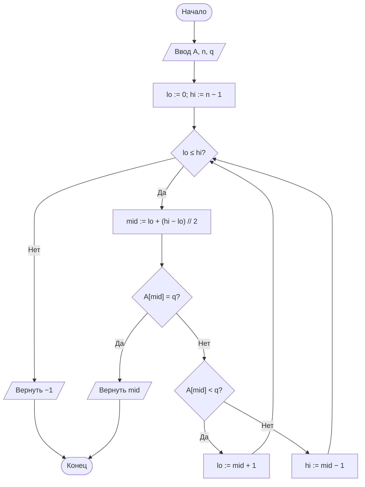
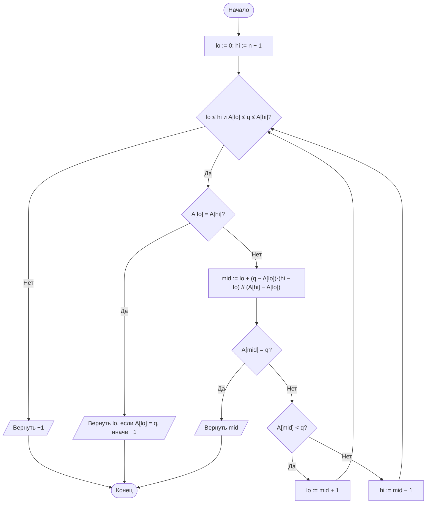
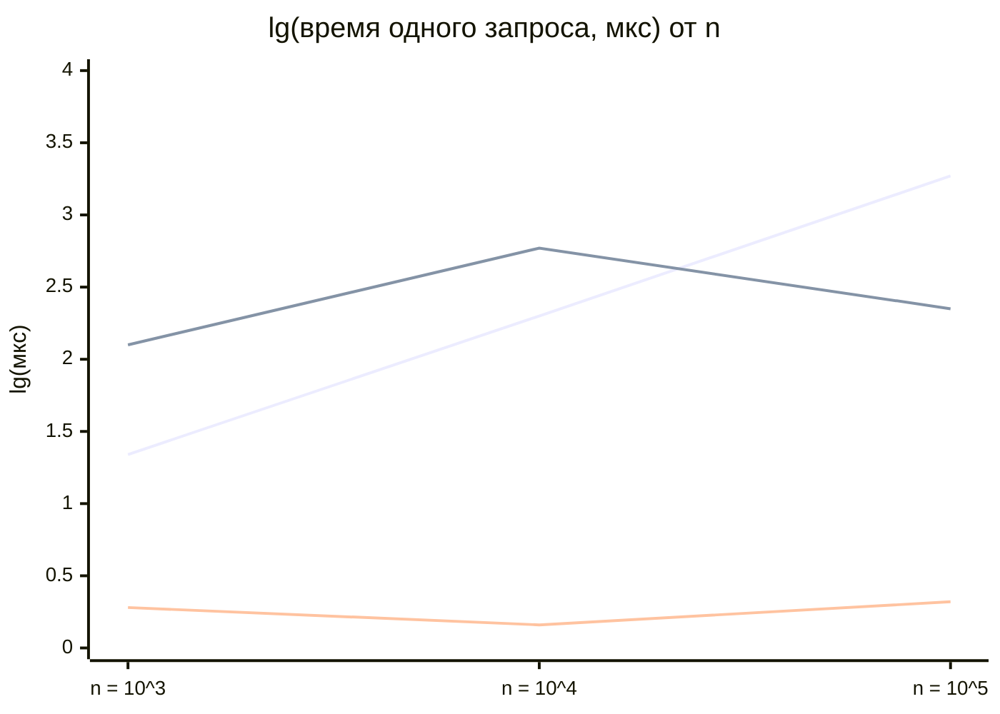
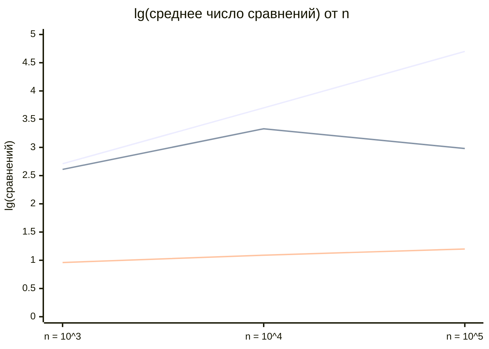

<div align="center">

**МИНИСТЕРСТВО НАУКИ И ВЫСШЕГО ОБРАЗОВАНИЯ РОССИЙСКОЙ ФЕДЕРАЦИИ**

&nbsp;

Направление подготовки: 38.03.05 «Бизнес-информатика»
Дисциплина: Теория алгоритмов

&nbsp;

# ОТЧЁТ

## по лабораторной работе № 4

### «Анализ алгоритмов последовательного, двоичного и интерполяционного поиска»

**Вариант 11**

&nbsp;

</div>

|  |  |
|---|---|
| **Выполнил:** | Колесный Степан |
| **Группа:** | БИ2-1 |
| **Проверил:** | ______________________ |

<div align="center">

2026 г.

</div>

---

## 1. Цель работы и задание варианта

**Цель работы:** изучить алгоритмы поиска элемента в массиве, экспериментально сопоставить их трудоёмкость с теоретическими оценками и определить условия, при которых предварительная сортировка данных оправдана.

**Задание варианта 11 (табл. 2 методических указаний):**

| Параметр | Значение |
|---|---|
| Размеры массива $n$ | $10^3$, $10^4$, $10^5$ |
| Распределение ключей | К — кластеризованное: 90 % ключей из $[0;\ n]$, 10 % из $[10^6;\ 10^7]$ |
| Число запросов $k$ | 500 |
| Тип запросов | успешные |
| Дополнительное задание | Б4 |

**Дополнительное задание Б4:** реализовать поиск границ диапазона (первое и последнее вхождение ключа) за $O(\log n)$ и подсчёт числа вхождений; проверить на массиве с повторами.

**Задачи работы:**

1. Реализовать последовательный, двоичный и интерполяционный поиск с подсчётом числа сравнений.
2. Измерить среднее время одного запроса и среднее число сравнений для каждого $n$.
3. Сопоставить результаты с теоретическими оценками $\frac{n+1}{2}$, $\log_2 n$, $\log_2 \log_2 n$.
4. Исследовать поведение интерполяционного поиска на кластеризованных данных.
5. Выполнить дополнительное задание Б4.

---

## 2. Описание алгоритмов и теоретические оценки

Задача поиска: в массиве $A$ из $n$ элементов найти индекс $i$ с $A[i] = q$ либо установить, что такого элемента нет. В данной работе все запросы **успешные**.

### 2.1. Последовательный (линейный) поиск

Элементы просматриваются подряд до совпадения. Упорядоченность не требуется. Среднее число сравнений при успешном поиске:

$$C_{\text{ср}} = \frac{1 + 2 + \ldots + n}{n} = \frac{n + 1}{2} = \Theta(n).$$

### 2.2. Двоичный поиск

Применим только к упорядоченному массиву: сравнивается средний элемент отрезка, поиск продолжается в левой или правой половине. Число сравнений в худшем случае

$$C_{\max} = \lfloor \log_2 n \rfloor + 1 = \Theta(\log n).$$

### 2.3. Интерполяционный поиск

Вместо середины вычисляется ожидаемая позиция ключа в предположении **равномерного** распределения значений:

$$mid = lo + \left\lfloor \frac{(q - A[lo]) \cdot (hi - lo)}{A[hi] - A[lo]} \right\rfloor.$$

При равномерном распределении ключей $O(\log \log n)$ сравнений, при произвольном (в том числе кластеризованном) — до $O(n)$.

### 2.4. Сводная таблица оценок

| Алгоритм | Упорядоченность | Лучший | Средний | Худший | Доп. память |
|---|---|---|---|---|---|
| Последовательный | Не требуется | $\Theta(1)$ | $\Theta(n)$ | $\Theta(n)$ | $O(1)$ |
| Двоичный | Требуется | $\Theta(1)$ | $\Theta(\log n)$ | $\Theta(\log n)$ | $O(1)$ |
| Интерполяционный | Требуется | $\Theta(1)$ | $\Theta(\log \log n)$\* | $\Theta(n)$ | $O(1)$ |

\* При равномерном распределении ключей.

### 2.5. Генерация данных (распределение К)

Массив из $n$ **различных** ключей: $0{,}9n$ значений выбираются случайно из $[0;\ n]$ (плотный кластер), оставшиеся $0{,}1n$ — из $[10^6;\ 10^7]$ (далёкие «выбросы»). Затем массив сортируется. Запросы — $k = 500$ случайно выбранных элементов массива (успешный поиск). Использованы фиксированные начальные значения генератора (`seed`), поэтому эксперимент воспроизводим.

---

## 3. Блок-схемы алгоритмов

### 3.1. Последовательный поиск



### 3.2. Двоичный поиск



### 3.3. Интерполяционный поиск



---

## 4. Листинг программы

Файл [`lab4_search.py`](lab4_search.py). Запуск: `python lab4_search.py` (для построения графиков нужен `matplotlib`).

```python
"""Лабораторная работа № 4. Вариант 11.
Последовательный, двоичный и интерполяционный поиск.
Данные: кластеризованное распределение ключей (К), n = 10^3, 10^4, 10^5,
k = 500 успешных запросов. Доп. задание Б4: границы диапазона и число вхождений.

Автор: Колесный Степан, группа БИ2-1.
Запуск: python lab4_search.py   (графики строятся, если установлен matplotlib)
"""
import bisect
import math
import os
import platform
import random
import time

SIZES = [10 ** 3, 10 ** 4, 10 ** 5]  # размеры массивов по варианту
K = 500                                # число запросов по варианту


# ---------------------------------------------------------------- алгоритмы поиска
def linear_search(a, q):
    """Последовательный поиск. Возвращает (индекс или -1, число сравнений)."""
    for i, value in enumerate(a):
        if value == q:
            return i, i + 1
    return -1, len(a)


def binary_search(a, q):
    """Двоичный поиск в упорядоченном массиве."""
    lo, hi, cmps = 0, len(a) - 1, 0
    while lo <= hi:
        mid = lo + (hi - lo) // 2          # безопасная форма середины отрезка
        cmps += 1
        if a[mid] == q:
            return mid, cmps
        if a[mid] < q:
            lo = mid + 1
        else:
            hi = mid - 1
    return -1, cmps


def interpolation_search(a, q):
    """Интерполяционный поиск в упорядоченном массиве."""
    lo, hi, cmps = 0, len(a) - 1, 0
    while lo <= hi and a[lo] <= q <= a[hi]:
        if a[lo] == a[hi]:                 # все элементы отрезка равны: деления на 0 быть не должно
            cmps += 1
            return (lo, cmps) if a[lo] == q else (-1, cmps)
        mid = lo + (q - a[lo]) * (hi - lo) // (a[hi] - a[lo])  # ожидаемая позиция ключа
        cmps += 1
        if a[mid] == q:
            return mid, cmps
        if a[mid] < q:
            lo = mid + 1
        else:
            hi = mid - 1
    return -1, cmps


# ---------------------------------------------------------------- данные и замеры
def make_clustered(n, seed=42):
    """Распределение К: 90 % ключей из [0; n], 10 % из [10^6; 10^7]. Ключи различны, массив упорядочен."""
    rng = random.Random(seed)
    n_low = int(0.9 * n)
    low = rng.sample(range(0, n + 1), n_low)               # 90 % - плотный кластер
    high = rng.sample(range(10 ** 6, 10 ** 7 + 1), n - n_low)  # 10 % - далёкие «выбросы»
    return sorted(low + high)


def benchmark(search_func, data, queries):
    """Среднее время одного запроса (с) и среднее число сравнений."""
    start = time.perf_counter()
    total = 0
    for q in queries:
        _, cmps = search_func(data, q)
        total += cmps
    return (time.perf_counter() - start) / len(queries), total / len(queries)


# ---------------------------------------------------------------- доп. задание Б4
def lower_bound(a, q):
    """Индекс первого элемента >= q и число сравнений. O(log n)."""
    lo, hi, cmps = 0, len(a), 0
    while lo < hi:
        mid = lo + (hi - lo) // 2
        cmps += 1
        if a[mid] < q:
            lo = mid + 1
        else:
            hi = mid
    return lo, cmps


def upper_bound(a, q):
    """Индекс первого элемента > q и число сравнений. O(log n)."""
    lo, hi, cmps = 0, len(a), 0
    while lo < hi:
        mid = lo + (hi - lo) // 2
        cmps += 1
        if a[mid] <= q:
            lo = mid + 1
        else:
            hi = mid
    return lo, cmps


def equal_range(a, q):
    """Границы вхождений ключа: (первый индекс, последний индекс, количество, сравнения)."""
    left, c1 = lower_bound(a, q)
    right, c2 = upper_bound(a, q)
    if left == right:                      # ключа в массиве нет
        return -1, -1, 0, c1 + c2
    return left, right - 1, right - left, c1 + c2


def test_equal_range(n=10 ** 5, trials=2000, seed=7):
    """Проверка Б4 на массиве с повторами: сравнение с bisect и с полным подсчётом."""
    rng = random.Random(seed)
    a = sorted(rng.randint(0, n // 10) for _ in range(n))   # в среднем ~10 повторов на ключ
    ok, cmps_sum = True, 0
    for _ in range(trials):
        q = rng.randint(-5, n // 10 + 5)                    # есть и существующие, и отсутствующие ключи
        first, last, cnt, cmps = equal_range(a, q)
        ref_l, ref_r = bisect.bisect_left(a, q), bisect.bisect_right(a, q)
        ok &= (cnt == ref_r - ref_l) and (cnt == a.count(q))
        ok &= (first == (ref_l if cnt else -1)) and (last == (ref_r - 1 if cnt else -1))
        cmps_sum += cmps
    return ok, cmps_sum / trials, math.log2(n)


# ---------------------------------------------------------------- запуск
def system_info():
    """Характеристики вычислительной системы для отчёта."""
    return (f"ОС: {platform.platform()}\nПроцессор: {platform.processor() or platform.machine()}\n"
            f"Логических ядер: {os.cpu_count()}\nPython: {platform.python_version()}")


def plot(results):
    """Графики времени и числа сравнений (логарифмические оси). Сохраняет graphs.png."""
    try:
        import matplotlib
        matplotlib.use("Agg")
        import matplotlib.pyplot as plt
    except ImportError:
        print("matplotlib не установлен - графики пропущены (pip install matplotlib)")
        return
    fig, ax = plt.subplots(1, 2, figsize=(11, 4.2))
    for name in ("Последовательный", "Двоичный", "Интерполяционный"):
        ax[0].plot(SIZES, [results[n][name][0] * 1e6 for n in SIZES], marker="o", label=name)
        ax[1].plot(SIZES, [results[n][name][1] for n in SIZES], marker="o", label=name)
    ax[1].plot(SIZES, [(n + 1) / 2 for n in SIZES], "k--", lw=0.8, label="теория (n+1)/2")
    ax[1].plot(SIZES, [math.log2(n) for n in SIZES], "k:", lw=0.8, label="теория log2 n")
    for a_, title, yl in zip(ax, ("Среднее время одного запроса", "Среднее число сравнений"), ("мкс", "сравнений")):
        a_.set(xscale="log", yscale="log", xlabel="n", ylabel=yl, title=title)
        a_.grid(True, which="both", alpha=0.3)
        a_.legend(fontsize=8)
    fig.tight_layout()
    fig.savefig("graphs.png", dpi=150)
    print("Графики сохранены в graphs.png")


if __name__ == "__main__":
    print("=== Характеристики системы ===")
    print(system_info())
    algorithms = {"Последовательный": linear_search, "Двоичный": binary_search,
                  "Интерполяционный": interpolation_search}
    rng = random.Random(1)
    results = {}
    for n in SIZES:
        data = make_clustered(n)
        queries = [rng.choice(data) for _ in range(K)]      # успешные запросы
        results[n] = {name: benchmark(f, data, queries) for name, f in algorithms.items()}

    print("\n=== Среднее время одного запроса, мкс ===")
    print(f"{'n':>8}" + "".join(f"{name:>20}" for name in algorithms))
    for n in SIZES:
        print(f"{n:>8}" + "".join(f"{results[n][name][0] * 1e6:>20.2f}" for name in algorithms))

    print("\n=== Среднее число сравнений ===")
    print(f"{'n':>8}{'послед.':>12}{'(n+1)/2':>12}{'двоичн.':>10}{'log2 n':>10}{'интерп.':>10}{'log2log2 n':>12}")
    for n in SIZES:
        r = results[n]
        print(f"{n:>8}{r['Последовательный'][1]:>12.1f}{(n + 1) / 2:>12.1f}{r['Двоичный'][1]:>10.1f}"
              f"{math.log2(n):>10.1f}{r['Интерполяционный'][1]:>10.1f}{math.log2(math.log2(n)):>12.1f}")

    print("\n=== Б4: границы диапазона и число вхождений ===")
    demo = [1, 2, 2, 2, 3, 5, 5, 8]
    print("Массив:", demo)
    for q in (2, 5, 4):
        print(f"  q = {q}: (первый, последний, количество, сравнений) =", equal_range(demo, q))
    ok, avg_cmps, lg = test_equal_range()
    print(f"Проверка на 2000 запросах (n = 10^5, с повторами): совпадает с bisect и подсчётом: {ok}")
    print(f"Среднее число сравнений equal_range: {avg_cmps:.1f} (2*log2 n = {2 * lg:.1f}), линейный подсчёт: ~10^5")
    plot(results)
```

---

## 5. Характеристики вычислительной системы

| Параметр | Значение |
|---|---|
| Операционная система | Linux 6.18 (x86_64, glibc 2.39) |
| Процессор | Intel Xeon @ 2,10 ГГц |
| Число логических ядер | 1 |
| Оперативная память | 4 ГБ |
| Версия Python | 3.12.3 |

Время измерялось функцией `time.perf_counter()`; для каждого $n$ суммарное время серии из 500 запросов делилось на число запросов. Абсолютные значения времени зависят от компьютера, а соотношения между алгоритмами — нет.

---

## 6. Результаты измерений

**Таблица 1. Среднее время одного запроса, мкс**

| $n$ | Последовательный | Двоичный | Интерполяционный |
|---|---|---|---|
| $10^3$ | 21,86 | 1,89 | 125,18 |
| $10^4$ | 199,89 | 1,46 | 590,91 |
| $10^5$ | 1866,42 | 2,11 | 224,59 |

**Таблица 2. Среднее число сравнений на один запрос**

| $n$ | Последовательный | Теория $\frac{n+1}{2}$ | Двоичный | Теория $\log_2 n$ | Интерполяционный | Теория $\log_2\log_2 n$ |
|---|---|---|---|---|---|---|
| $10^3$ | 514,8 | 500,5 | 9,1 | 10,0 | 405,1 | 3,3 |
| $10^4$ | 5027,3 | 5000,5 | 12,2 | 13,3 | 2124,5 | 3,7 |
| $10^5$ | 50 057,3 | 50 000,5 | 15,7 | 16,6 | 959,7 | 4,1 |

### Графики

Графики построены в логарифмическом масштабе: по оси абсцисс — размер массива $n$ ($10^3$, $10^4$, $10^5$), по оси ординат — десятичный логарифм измеренной величины. Линии идут в порядке: 1) последовательный, 2) интерполяционный, 3) двоичный (цвета mermaid назначает автоматически). Точные значения приведены в таблицах 1 и 2. Графики с исходными (не логарифмированными) значениями программа сохраняет в файл `graphs.png`.

**Рис. 1. Среднее время одного запроса, lg(мкс)**



Порядок линий в данных: 1) последовательный, 2) интерполяционный, 3) двоичный.

**Рис. 2. Среднее число сравнений, lg**



Порядок линий в данных: 1) последовательный, 2) интерполяционный, 3) двоичный.

### Анализ результатов

1. **Последовательный поиск** подтверждает теорию: число сравнений (514,8; 5027,3; 50 057,3) почти совпадает с $\frac{n+1}{2}$. При росте $n$ в 10 раз время растёт в 9,1 и 9,3 раза, что соответствует $\Theta(n)$.
2. **Двоичный поиск** выполняет 9,1; 12,2 и 15,7 сравнений. Это немного меньше $\log_2 n$, поскольку $\log_2 n$ — оценка худшего случая, а при успешном поиске в среднем требуется примерно на единицу меньше. Время почти не меняется (1,5–2,1 мкс), что соответствует $\Theta(\log n)$.
3. **Интерполяционный поиск на кластеризованных данных не оправдывает теоретических оценок:** вместо 3–4 сравнений он делает 405, 2125 и 960, то есть в 45–174 раза больше двоичного поиска. По времени он медленнее двоичного в 66, 405 и 106 раз; при $n = 10^3$ и $n = 10^4$ он проигрывает даже последовательному поиску (в 5,7 и 3,0 раза), и лишь при $n = 10^5$ быстрее него (в 8,3 раза).
4. **Причина деградации.** Оценка $O(\log \log n)$ верна только при равномерном распределении. Здесь значение $A[hi]$ определяется «выбросами» порядка $10^7$, тогда как 90 % ключей лежат в диапазоне $[0;\ n]$. Дробь $\frac{hi - lo}{A[hi] - A[lo]} \approx \frac{n}{10^7}$ очень мала, поэтому пробная позиция $mid$ оказывается почти равной $lo$, и поиск продвигается на единицы элементов за шаг, то есть превращается в почти линейный просмотр плотного кластера. Каждый шаг при этом дороже, чем в линейном поиске (умножение и деление).

---

## 7. Дополнительное задание Б4: границы диапазона и число вхождений

Реализованы функции `lower_bound` (индекс первого элемента $\ge q$) и `upper_bound` (индекс первого элемента $> q$), обе работают по схеме двоичного поиска за $O(\log n)$. Функция `equal_range` объединяет их: первое вхождение — `lower_bound`, последнее — `upper_bound − 1`, число вхождений — `upper_bound − lower_bound`; если они равны, ключа в массиве нет.

**Демонстрация** на массиве `[1, 2, 2, 2, 3, 5, 5, 8]` (результат — первый индекс, последний индекс, количество, число сравнений):

| Ключ $q$ | Результат |
|---|---|
| 2 | (1, 3, 3, 7) |
| 5 | (5, 6, 2, 6) |
| 4 (отсутствует) | (−1, −1, 0, 6) |

**Проверка на большом массиве с повторами.** Массив из $n = 10^5$ случайных целых из $[0;\ 10^4]$ (в среднем около 10 повторов на ключ). На 2000 запросах (существующие и отсутствующие ключи) результат `equal_range` совпал с `bisect.bisect_left`, `bisect.bisect_right` и с прямым подсчётом `list.count` — **расхождений нет**.

**Трудоёмкость.** В среднем `equal_range` выполняет 33,4 сравнения (два двоичных поиска: $2 \log_2 n \approx 33{,}2$), тогда как линейный подсчёт вхождений требует просмотра всех $\approx 10^5$ элементов. Если нужно не только посчитать, но и перечислить все $m$ вхождений, достаточно $O(\log n + m)$ операций.

---

## 8. Выводы

1. Экспериментальные данные подтверждают теоретические оценки для последовательного и двоичного поиска: число сравнений близко к $\frac{n+1}{2}$ и $\log_2 n$ соответственно. Время последовательного поиска растёт пропорционально $n$ (в 9–10 раз при росте $n$ в 10 раз), время двоичного практически постоянно (1,5–2,1 мкс).
2. Интерполяционный поиск на кластеризованных данных (распределение К) **деградирует**: 405–2125 сравнений вместо теоретических 3–4; по времени он в 66–405 раз медленнее двоичного и на малых $n$ уступает даже последовательному. Причина — нарушение предположения о равномерности: «выбросы» искажают оценку позиции, и поиск превращается в почти линейный просмотр.
3. Следовательно, превосходство интерполяционного поиска нельзя переносить на произвольные данные. Для неравномерных и заранее неизвестных по распределению данных надёжным выбором остаётся двоичный поиск, у которого трудоёмкость $\Theta(\log n)$ не зависит от распределения ключей.
4. Двоичный поиск обобщается на задачу нахождения границ диапазона. Функции `lower_bound` и `upper_bound` находят первое и последнее вхождение ключа и число вхождений за $O(\log n)$; корректность подтверждена сравнением с модулем `bisect` на 2000 запросах (среднее число сравнений 33,4 при $n = 10^5$).
